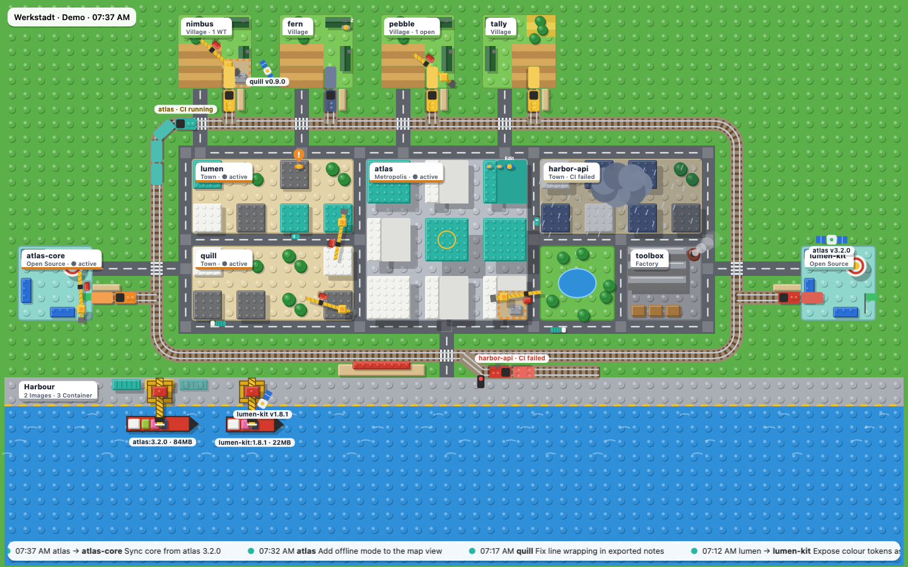
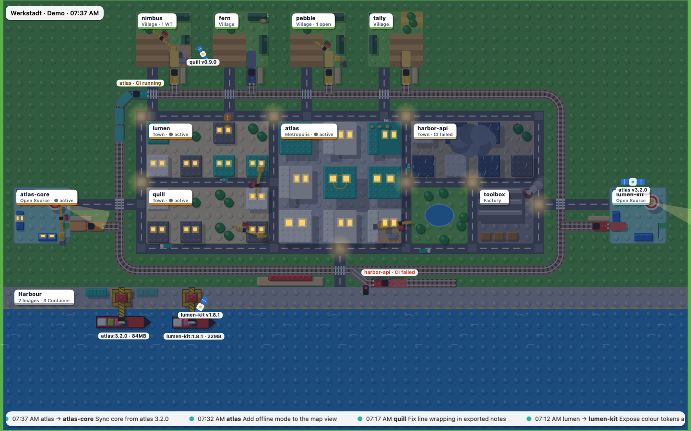

# Werkstadt

A live map of your projects as a top-down toy-brick town. Every git repo is a town, Claude Code sessions walk around as figures, each new commit is one car trip, CI runs are trains, the latest releases orbit as satellites, and published container images lie in the harbour.



Runs on your own machine. Python standard library only, no build step, no account, nothing leaves your network.

## Setup

```sh
git clone <this repo> && cd werkstadt
python3 setup.py
```

The wizard asks where your repos live, which ones are open-source cores or shared tooling, and which repo feeds changes into which. It then offers to install the Claude Code hooks, autostart (launchd on macOS, systemd user unit on Linux) and the Home Assistant webhook. Everything it learns goes into `werkstadt.local.json`, which is not tracked by git.

| Command | What it does |
|---|---|
| `python3 setup.py` | interactive setup; run again any time to change answers |
| `python3 setup.py --defaults` | no questions: write a config from detected values, install nothing |
| `python3 setup.py --check` | print what is set up, as JSON |
| `python3 setup.py --uninstall` | remove hooks and autostart; keeps the config |
| `python3 collector.py` | start by hand: http://localhost:7777, full screen for a wall tablet: `/?tv` |

To look at the map before pointing it at your own repos, open `http://localhost:7777/?demo`: it shows invented sample data. The interface follows the browser language (German or English); force one with `?lang=de` or `?lang=en`.

Needs `git` and `curl`. Optional: `gh` (logged in) for CI status and for suggesting public repos, `docker` for containers on the quay.

## What you see

| Real thing | On the map |
|---|---|
| Repo, by tracked files and commits of the last 30 days | metropolis (≥ 1,000 files or 500 commits), town (≥ 400 files), village |
| Open-source core (`oss`) | harbour village with a lighthouse, outside the ring |
| Shared tooling (`werk`) | factory |
| Villages and cores | outside the rail ring, linked by a branch line and a country road |
| Activity: session working or commit < 30 min; uncommitted changes or commit < 3 h | crane turning fast with beacon and most lights on at night; crane turning slowly, some lights; otherwise dark |
| Open worktrees | construction site |
| Each new commit (last 30 min on load, then live) | one car trip: feeder → core along the roads, otherwise one lap around its own town; scrolling ticker at the bottom |
| Claude Code session working / waiting for you / idle | blue figure walking / orange "!" / grey "z"; small figures are subagents |
| CI run in progress / latest run failed | train circling the ring / red train on the siding and a storm over that town only |
| Tags of the last 14 days | satellites |
| `ghcr.io/<owner>/<name>` references in your repos | ships in the harbour, with newest version and size from the registry |
| Docker containers | containers on the quay |

Repos with fewer than 20 files or no commit in 30 days are left off the map.

At night only active repos are lit:



Both pictures show the built-in demo data (`/?demo`). `?time=day` or `?time=night` fixes the view instead of following the clock.

## How it gets its data

- **Git**, every 60 s: files, commits, tags, worktrees and uncommitted changes of every repo under the configured folders (two levels deep). Only local state; a commit made elsewhere shows up after you fetch.
- **GitHub CLI**, every 90 s: the latest Actions run of active repos. Read-only, triggers nothing.
- **Registry**, every 15 min: public `ghcr.io` images referenced in tracked files, looked up anonymously.
- **Docker**, every 60 s: `docker ps -a` and `docker images`, also for remote hosts in `docker_hosts` (e.g. `ssh://user@nas`).
- **Claude Code hooks**: each event is piped to `tool/hook.sh`, which posts it to the collector on localhost with a 1 s timeout and never blocks. Only session id, repo, event and tool name are kept, never prompts or file contents.

## Config (`werkstadt.local.json`)

```json
{
  "roots": ["~/code"],
  "host": "127.0.0.1",
  "port": 7777,
  "aliases": {"folder-name": "name-on-the-map"},
  "skip": ["repo-to-hide"],
  "oss": ["my-library"],
  "werk": ["shared-tooling"],
  "links": [["my-app", "my-library"]],
  "docker_hosts": ["ssh://user@nas"],
  "home_assistant": {"url": "http://homeassistant.local:8123", "webhook_id": "…"}
}
```

`host` is `127.0.0.1` (this machine only) or `0.0.0.0` (reachable in your network, needed for a tablet or Home Assistant). There is no login, so do not expose the port to the internet.

## Home Assistant

- Show the map: a dashboard with a webpage card on `http://<host>:7777/?tv`. This works when Home Assistant is opened over plain http in the home network; over https browsers block the embedded http page.
- Waiting sessions as an entity: the collector posts `{"waiting": n}` to a local-only webhook whenever the number changes. The wizard generates the webhook id and prints the automation to paste.

## MCP server

```sh
claude mcp add werkstadt -- python3 /path/to/werkstadt/mcp_server.py
```

Read-only, two tools: `werkstadt_status` (waiting and working sessions, active repos, uncommitted changes, CI, releases, recent commits, images) and `werkstadt_setup_check` (what is set up and the next step). The setup itself stays in the terminal wizard, because it changes your Claude settings and autostart.

## License

GPL-3.0-or-later, see [LICENSE](LICENSE).
